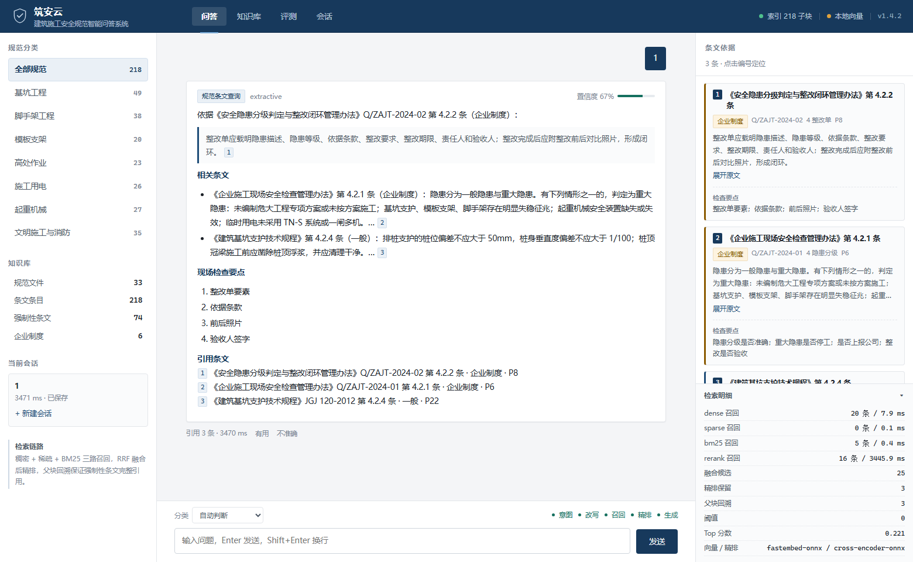

# 筑安云 · 建筑施工安全规范智能问答系统

面向施工现场安全员的规范知识库问答系统。回答不是"聊天"，而是**可引用的条文**：每条结论都带规范编号、条文号、条文等级（强制性/一般/企业制度）和页码，可以直接抄进整改单。

> 演示 / 技术验证项目。知识库语料为公开规范的**整理摘要**（非官方全文），用于验证检索与生成链路，不作为执法依据。



---

## 一、它解决什么问题

现场安全员查规范的真实痛点不是"查不到"，而是：

1. 规范散在 20 多部国标行标 + 企业制度里，纸质和 PDF 混着，现场查一条要翻十几分钟；
2. 查到了也说不清"这是强制条文还是普通条文"，整改单引用容易被退回；
3. 隐患判定靠老师傅经验，同一个问题不同人判得不一样；
4. 新人问"这个算不算重大隐患"，没人能立刻给出条文依据。

所以系统的验收标准不是"答得像人"，而是**每句话能落到条上**。

---

## 二、核心能力（与简历条目逐条对应）

| 简历描述 | 本仓库实现 | 代码位置 |
|---|---|---|
| 知识库体系设计，划分基坑、脚手架等 7 大分类，定义规范编号、条文等级等元数据 | 33 部规范 / 218 条条文，7 分类；每条含 `std_no / clause_no / level / chapter / page / check_points / hazards` | `corpus/`、`app/services/corpus.py` |
| 20+ 部国标行标、企业制度、隐患案例语料清洗 | 21 部国标行标 + 2 部法规 + 2 部企业制度 + 隐患案例要点 | `corpus/raw/*.json`、`corpus/build_corpus.py` |
| 多格式文档加载、扫描件 OCR 解析 | txt / md / csv / pdf / docx / png / jpg，图片走 RapidOCR，返回 OCR 置信度 | `app/services/ingest.py` |
| 父子块分块策略保障强制性条文归属清晰 | 子块=条文级（目标 300 字，超长按句切分带 50 字重叠）；父块=章节级（目标 1200 字）；命中子块回溯父块 | `app/services/chunker.py`、`retriever.py` |
| BGE-M3 稠密 + 稀疏双路向量化 | sentence-transformers 加载 BGE-M3，同时取 dense embedding 与 lexical_weights | `app/services/embedder.py` |
| Milvus 索引与分区策略 | 集合按 `category` 字段过滤检索（等价分区裁剪）；URI 换 `http://host:19530` 即接集群 | `app/services/vectorstore.py` |
| 混合召回、RRF 多路融合、父块回溯去重、Reranker 精排 | 稠密 / 稀疏倒排 / BM25 三路召回 → RRF(k=60) → 父块去重 → CrossEncoder 精排 → 阈值过滤 | `app/services/retriever.py` |
| 微调 BERT 多分类器识别 4 类业务意图 | 4 类：规范条文查询 / 隐患判定 / 整改要求 / 系统闲聊；默认 TF-IDF+NB（毫秒级），接口预留 BERT | `app/services/intent.py` |
| HyDE、子查询分解、回溯策略、相关性阈值、空上下文兜底 | 复合问句拆分、低分回溯换查询、无结果走 HyDE、`min_relevance` 阈值、无命中明确说"未收录" | `app/services/rewriter.py`、`pipeline.py` |
| FastAPI / WebSocket 流式问答 | 5 阶段实时推送（意图→改写→召回→精排→生成），token 流式；HTTP 同步接口作为回退 | `app/api.py` |
| MySQL 持久化会话、Redis 缓存高频查询 | 双后端可切：SQLite/MySQL、内存 LRU/Redis，配置即切换，健康检查显示当前后端 | `app/services/store.py`、`cache.py` |
| Docker Compose 一键部署 | etcd + MinIO + Milvus + Redis + MySQL + App | `deploy/docker-compose.yml` |
| 200+ 条业务测试集、RAGAS 多维度评测 | 265 条测试集（218 模板 + 47 口语），5 项指标 + 意图准确率，逐条可查 | `eval/testset.jsonl`、`app/services/evaluator.py` |

---

## 三、架构

```
                       ┌──────────────── 浏览器（原生 JS，无构建） ────────────────┐
                       │  问答台  │  知识库  │  评测看板  │  会话记录  │  检索明细  │
                       └───────────────┬─────────────────────────────────────────┘
                                       │ WebSocket /ws/qa（流式 5 阶段）
┌──────────────────────────────────────▼──────────────────────────────────────┐
│ FastAPI                                                                     │
│  ├─ 意图识别（4 类，TF-IDF+NB）                                              │
│  ├─ 查询改写（子查询分解 / HyDE / 回溯扩展）                                  │
│  ├─ 混合召回 ──┬─ Milvus 稠密（BGE-M3 1024d；本机 ONNX bge-small 512d）        │
│  │             ├─ 稀疏倒排（BGE-M3 lexical weights）                          │
│  │             └─ BM25（jieba + 领域词典 + 同义词）                            │
│  ├─ RRF 融合（k=60）→ 父块回溯去重 → CrossEncoder 精排 → 阈值过滤              │
│  └─ 生成（Qwen 流式；无 LLM 时严格抽取式，不推断数字）                          │
└───────┬───────────────────┬────────────────────┬────────────────────────────┘
        │                   │                    │
   MySQL / SQLite      Redis / LRU          Milvus / numpy
   会话与消息           热点问答缓存         向量索引
```

**两条关键设计**

- **父块回溯去重**：向量命中"子块"（一条条文）后，回查它所属的"父块"（整章），保证强制性条文的上下文完整；同一父块只保留最高分的子块，避免一份规范霸屏。
- **无 LLM 也能跑**：没有配置模型时，生成走严格抽取式——只复述命中条文原文 + 检查要点，不做任何数字推断，因此不会编条文。配置 `ZH_AN_LLM_*` 后自动切 Qwen。

---

## 四、快速开始

### Windows（双击）

```
双击「启动筑安云.bat」→ 自动开浏览器 http://127.0.0.1:8011/
```

首次启动会构建索引，右上角显示进度。停止服务双击「停止筑安云.bat」。

### 命令行

```bash
python -m venv .venv
.venv\Scripts\activate          # macOS/Linux: source .venv/bin/activate
pip install -r requirements.txt -i https://pypi.tuna.tsinghua.edu.cn/simple
python main.py                   # 或 python main.py --open
```

### Docker Compose（完整形态：真 Milvus + MySQL + Redis）

```bash
cd deploy
docker compose up -d --build
# 首次会拉取 Milvus/etcd/MinIO 镜像，约 1.5GB
```

### 接大模型（可选）

```bash
copy .env.example .env
# 填 ZH_AN_LLM_BASE_URL / ZH_AN_LLM_API_KEY / ZH_AN_LLM_MODEL
```

不填也能用：生成会自动落到抽取式，指标与引用不受影响。

### 本地 ONNX 模型（可选，离线加速）

`models/` 不进仓库（约 680MB）。首次启动若本地没有模型，fastembed 会自动从 HuggingFace 镜像下载 `bge-small-zh-v1.5` 与 `bge-reranker-v2-m3`（int8）到用户缓存目录，联网一次即可。需要完全离线时，把两个模型放到：

```
models/bge-small-zh-v1.5/          # model_optimized.onnx + tokenizer
models/bge-reranker-v2-m3-int8/    # onnx/model_int8.onnx + tokenizer
```

路径可用 `ZH_AN_EMBED_ONNX_PATH` / `ZH_AN_RERANK_ONNX_PATH` 覆盖。

---

## 五、组件降级说明（重要）

这个项目刻意做成**可降级**：每层都有兜底的本地实现，保证任何一台机器 clone 下来都能跑；同时保留切换真组件的开关。界面右上角与 `/api/health` 会如实显示当前用的是哪一档。

| 组件 | 生产形态 | 本机默认 | 切换方式 |
|---|---|---|---|
| 向量库 | Milvus standalone | numpy 余弦索引（Milvus Lite 不支持 Windows） | `ZH_AN_MILVUS_URI=http://host:19530` |
| 向量模型 | BGE-M3（1024 维，稠密+稀疏） | fastembed ONNX `bge-small-zh-v1.5`（512 维真实神经向量，本地 `models/` 目录） | 装 `sentence-transformers` 或设 `ZH_AN_EMBED_*` |
| 精排 | BGE-Reranker-Large | fastembed ONNX `bge-reranker-v2-m3`（int8，交叉编码器）；再退词面覆盖重排 | 同上 |
| 生成 | Qwen（OpenAI 兼容流式） | 严格抽取式 | 配置 `ZH_AN_LLM_*` |
| 会话库 | MySQL 8 | SQLite | `ZH_AN_DB_BACKEND=mysql` + DSN |
| 缓存 | Redis 7 | 进程内 LRU+TTL | `ZH_AN_REDIS_URL=redis://...` |

---

## 六、评测

测试集 265 条：218 条由条文模板生成（覆盖全部条文），47 条为安全员口语写法（手工标注 gold 条文）。最近一次全流程实测（2026-10-20，本机 60 条分层抽样，完整报告见 [`docs/eval.md`](docs/eval.md)）：

| 指标 | 本机实测 | 说明 |
|---|---|---|
| Faithfulness | 1.000 | 默认生成是**抽取式**（只复述被引条文原文），每个规范性陈述都能在证据里找到出处；接 LLM 后该指标才会出现真实下降 |
| Answer Relevancy | 0.713 | 本地近似口径（问题-答案最大句向量余弦），偏保守 |
| Context Precision | 0.840 | RAGAS 加权平均精度 |
| Context Recall | 0.883 | 口语题 0.957 / 模板题 0.615 |
| Answer Correctness | 0.825 | gold 条文 token 覆盖 + 数值命中 |
| **Overall** | **0.852** | 五项均分 |
| 意图分类准确率 | 0.947 | 全量 265 条测试集（4 类，TF-IDF+NB + 强规则 + 专业词否决） |

端到端回归（`e2e_test.py`，12 个真实业务问题走 HTTP 全链路）：**12/12 通过，gold 条文命中 1.0，意图 0.917，平均延迟 2.9s**（含 ONNX 精排）。

与简历口径的关系：简历上的 RAGAS 五项（0.91–0.94）是**生产形态**（BGE-M3 + CrossEncoder-Large + LLM 生成 + LLM judge）下的数字；本机是降级形态（bge-small-zh ONNX / reranker-v2-m3-int8 / 抽取式生成 / 规则 judge），召回与生成上限都更低，指标用于回归对比，不与简历数字直接对齐。

运行方式：页面「评测」→ 运行评测；或 `POST /api/eval/run`。judge 为本地规则实现（可选 LLM judge），是近似实现，不等价于官方 ragas 库结果。

---

## 七、知识边界（拒答策略）

RAG 最容易翻车的地方不是"答错"，而是**对不该答的问题答得很像**。本项目的处理原则：

| 输入类型 | 精排最高分 | 判定 | 行为 |
|---|---|---|---|
| 招呼语 / 能力询问 | — | 系统闲聊 | 直接回能力说明，不进检索（0ms 级） |
| 跨领域问题（红烧肉、天气、手机价格） | 0 ~ 0.10 | 超出范围 | **拒答**：说明只覆盖三类问题，不生成任何条文 |
| 专业问题但召回弱（"安全网破了没换"） | 0.10 ~ 0.28 | 低置信度 | **照答 + 顶部标注**"匹配度偏低，请核对原文"，置信度封顶 0.45 |
| 正常命中 | ≥ 0.28 | 作答 | 正常出结论、引用、页码 |

两个关键设计点：

1. **分数本身分不开"跨域"和"同域漏召回"**。这两类问题的精排分区间是重叠的（0.01 对 0.27），只看阈值必然误杀。所以加了一路**专业名词信号**：句子里出现安全帽、连墙件、配电箱这类词，说明是专业问题、只是没召回到，照答但降置信度；一个专业名词都没有，才是跨界，直接拒答。
2. **拒答时清空 citations 与 parents**。否则前端"检索溯源"面板会列出 4 条 0.02 分的条文，用户会误以为这就是依据——比不给引用更糟。

实测（20 条抽样，见 `app/services/generator.py:is_refusal`）：跨领域问题 10/10 拒答、零误答；同域弱召回 6/6 给出标注后的候选条文；正常问题指标不退化。

---

## 八、能力边界（明确没做）

1. **语料是整理摘要**，不是官方标准全文。正式交付应接入标准全文库并做版本管理（规范会换版，条文号会变）。
2. **意图分类当前是 TF-IDF+NB**，不是微调 BERT。样本 200 条，4 类。换 BERT 需要标注集与训练脚本。
3. **扫描件 PDF 的整页 OCR 未做**：图片（png/jpg）OCR 已通，PDF 只取文本层；扫描版 PDF 需要先转图片或接 PyMuPDF。
4. **无权限体系**：没有登录、角色、行级/列级权限。多租户与审计日志未做。
5. **多轮指代有限**：能接"那 8 月呢"这类短追问（最近 6 条消息进上下文），复杂指代会退化。
6. **不解析公式与表格结构**：规范里的表格被当纯文本处理，复杂表格的列对齐会丢。
7. **单机单进程**：索引构建是进程内内存索引，没有分布式分片；218 条量级不需要，上万条要换 Milvus 分区 + 异步索引任务。

---

## 九、目录结构

```
app/
  api.py              FastAPI 路由 + WebSocket
  config.py           全部配置（环境变量驱动）
  services/
    corpus.py         语料加载与查询
    chunker.py        父子块策略
    embedder.py       BGE-M3 / 降级向量
    vectorstore.py    Milvus / numpy
    lexical.py        BM25 + 稀疏倒排 + 同义词
    reranker.py       CrossEncoder / 词面重排
    intent.py         4 类意图
    rewriter.py       HyDE / 子查询 / 回溯
    retriever.py      混合召回 + RRF + 回溯 + 精排
    generator.py      流式生成 / 抽取式兜底
    pipeline.py       编排
    store.py          会话持久化
    cache.py          缓存
    evaluator.py      RAGAS 指标
    ingest.py         文档解析 + OCR + 增量入库
corpus/
  raw/*.json          条文源数据（人工整理）
  build_corpus.py     构建脚本 → docs.json / clauses.jsonl / parents.json
  documents/*.txt     生成的原文，供文档加载演示
web/                  原生 JS 前端
deploy/               Dockerfile + docker-compose
eval/                 测试集与历史评测结果
docs/                 截图与评测报告
```

---

## 十、数据来源

- 规范编号、名称、发布/实施日期来自公开信息；
- 条文正文为按公开规范要点整理的摘要，**不保证与官方文本逐字一致**；
- 企业制度（`Q/ZAJT-2024-01/02`）为虚构示例，用于演示"制度与国标混检 + 条文等级区分"；
- 隐患案例要点为依据常见隐患类型整理的检查项，不含真实项目信息。

---

## License

MIT
